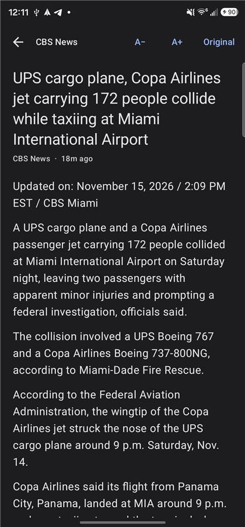
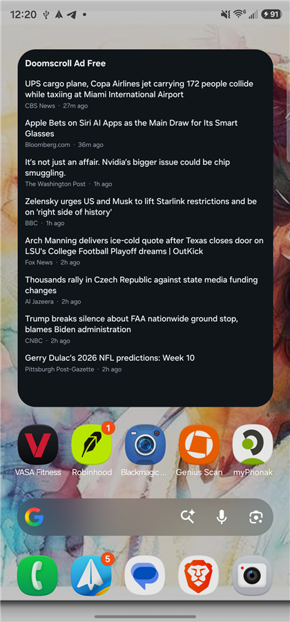
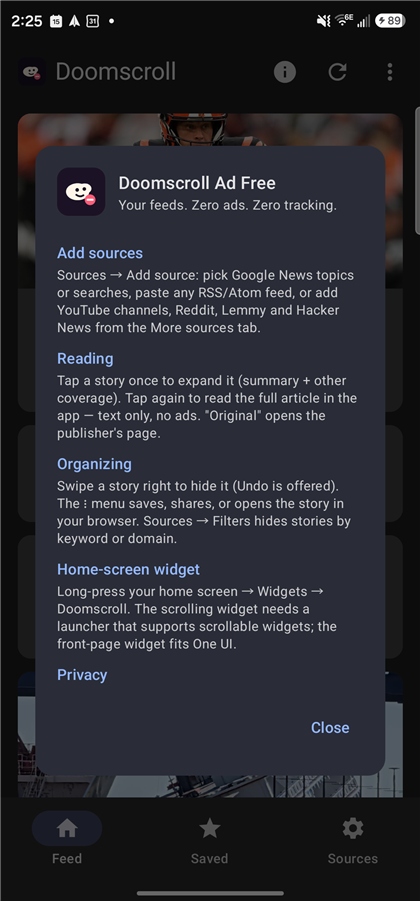

# Doomscroll Ad Free

[](https://github.com/iamoutofmana/doomscroll-ad-free/actions/workflows/android-ci.yml)

**An ad-free, open-source replacement for your phone's "media page."**
News, videos, podcasts, and community posts from sources *you* choose — zero ads, zero sponsored items, zero tracking.

Started because the Samsung media page shows ads and there is no way to replace it with your own app. This is the workaround — and it's better.

## The three promises

1. **No ads. No sponsored items. Ever.** No ad SDKs, no analytics, no trackers — plus an on-device filter that removes sponsored/advertorial items publishers sneak into feeds.
2. **Your data stays on your phone.** No account, no telemetry. The app only ever talks to the feeds *you* configure — plus the article pages you open a preview for.
3. **Open source, forever.** GPL-3.0, FOSS-only dependencies, intended for F-Droid.

## Roadmap

| What | Phase |
|---|---|
| Google News topics, searches & local feeds (Discover-style, via public RSS) + any RSS/Atom/JSON feed | 1 |
| Home-screen feed widget — the actual media-page replacement | 2 |
| Sponsored-item filtering + built-in ad-free reader mode | 2 |
| YouTube channels, podcasts, Reddit, Lemmy, Hacker News | 3 |
| Topic packs (AI, construction, Salt Lake City, food, business) + paste-a-link feed discovery | 3 |
| Feed topic chips (All / AI / Construction / SLC / Food / Business / Other) | 3 |
| On-device "For You" ranking | 4 |
| First stable release (GitHub + self-hosted F-Droid repo; official F-Droid pending the 3-month rule) | 5 |

## Screenshots

| Feed | Reader mode |
|---|---|
|  |  |

| Home-screen widget | In-app help |
|---|---|
|  |  |

Full plan: [`docs/PLAN.md`](docs/PLAN.md)

## Install

**v1.1.0 is released.**

### With automatic updates (recommended)

Add the developer-hosted F-Droid repo to **F-Droid**, **Droid-ify** or **Neo Store**:

1. Settings → Repositories → **+**
2. Paste `https://iamoutofmana.github.io/doomscroll-ad-free/repo`
3. Search for **Doomscroll** and install — future updates arrive automatically.

Repo page with the same instructions: https://iamoutofmana.github.io/doomscroll-ad-free/

Repo signing key SHA-256:
`93:93:39:66:83:61:09:CB:F2:33:1F:E9:9F:E9:51:3E:ED:04:8C:F0:A9:F4:49:D2:AA:D6:94:31:3C:79:20:60`

> This repo is run by the project, not by F-Droid, and is not reviewed by them; the
> fingerprint above is the trust anchor. It serves the same release-key-signed APK as
> GitHub Releases, so switching between the two needs no uninstall.

### Manual APK

Download the signed APK from
[GitHub Releases](https://github.com/iamoutofmana/doomscroll-ad-free/releases) and sideload it
(Android 8+).

Official F-Droid inclusion is pending their 3-month maintenance requirement; the
self-hosted repo above fills the gap meanwhile.

> **Signing note:** GitHub/self-hosted builds are signed with the project key; an official
> F-Droid build uses F-Droid's key. Pick one distribution and stick with it — switching
> from the project-signed APK to an F-Droid-signed build requires uninstalling.

### Replacing your media page (once the widget ships — Phase 2)

1. Home screen settings → turn **off** the media page / Google Discover panel
2. Long-press the wallpaper → **Widgets** → *Doomscroll Ad Free* → drop the 4×5 feed widget on a dedicated page
3. Done — swipe over whenever you want your feeds

## Build from source

Requires JDK 17.

```
git clone https://github.com/iamoutofmana/doomscroll-ad-free
cd doomscroll-ad-free
./gradlew assembleDebug
```

APK lands in `app/build/outputs/apk/debug/`.

## Privacy

*Doomscroll Ad Free collects nothing.* No accounts, no analytics, no crash reporting, no ads. All feeds, preferences, and reading history live in the app's local database on your device.

## Contributing

See [CONTRIBUTING.md](CONTRIBUTING.md). Bug reports and ideas are welcome any time.

## License

[GPL-3.0-or-later](LICENSE) © 2026 iamoutofmana
